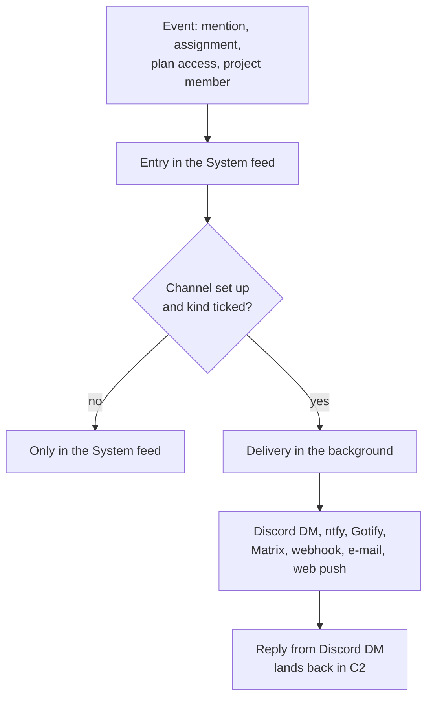
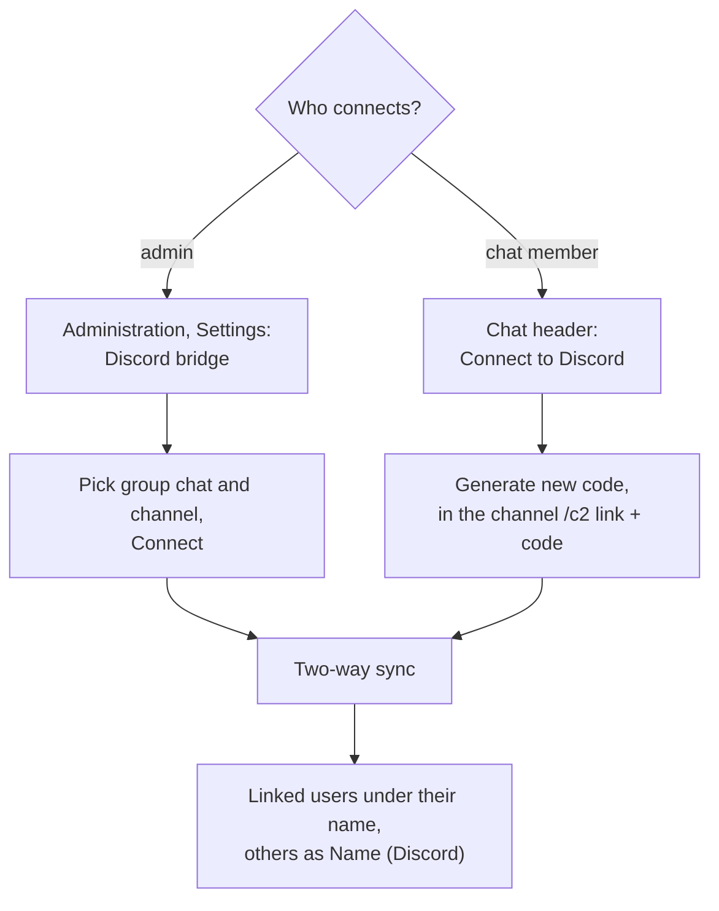
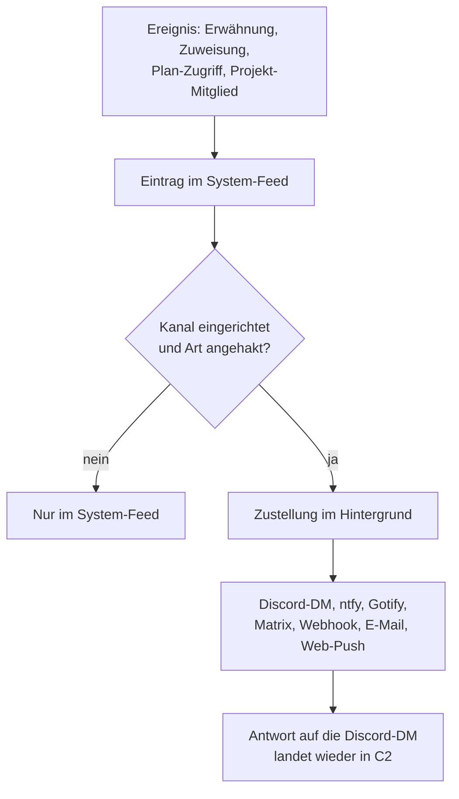
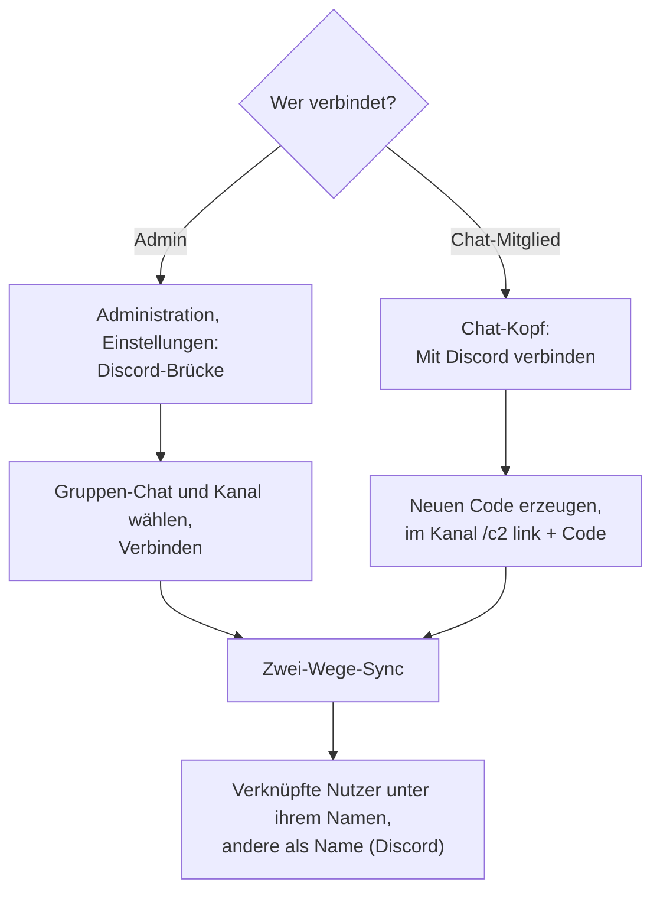

# SIDC – C2 — Chat & notifications

**What is this page about?** Talking inside C2 (chat, System feed, task discussions) and getting notified outside of it — Discord direct message, ntfy, Gotify, Matrix, webhook, e‑mail, web push — plus the **Discord bridge** that mirrors group chats into Discord channels. **For whom?** All users; the server part (bot, `.env`) is for admins. Overview: [SIDC – C2](SIDC-C2-Command-Control).

## 1. Chat

Sidebar **Chat** (badge = unread messages).

| Conversation type (*New conversation*) | Members |
|---|---|
| **Direct** | you and one person (*Search people …*) |
| **New group** | free group with a *Group name*; *Add member*, *Rename*, *Leave group* |
| **From group/project** | chat for an existing admin group or a project — members follow the source automatically; `@project` addresses everyone |

- `Enter` sends, `Shift+Enter` = new line. Mention with `@name` / `@group` (autocomplete) — the person is notified.
- Messages can be deleted. New messages arrive by polling (about every 3 s in the open chat, badge every 10 s).
- Task discussions and file comments in projects work the same way (see [Projects](SIDC-C2-Projects)).

## 2. System feed

The fixed conversation **System** (*Mentions & assignments*) at the top of the chat collects all notifications. Each entry has **Reply** — the answer lands in the chat or as a task comment and marks the entry read. *Mark all read*, *Clear read*.

## 3. Notifications outside the page

Gear → **Notifications** → *Add channel*.

| Channel | Notes |
|---|---|
| **Discord (direct message)** | created automatically once your Discord account is linked (section 4) or the admin entered your Discord ID; you choose the kinds or switch it off |
| **ntfy (push to the phone)** | ntfy topic/server |
| **Gotify** | self‑hosted push |
| **Matrix** | room message |
| **Webhook (JSON)** | generic JSON POST, optionally HMAC‑signed |
| **E‑mail** | only if the server has `SMTP_HOST` set — otherwise greyed out |
| **Browser / smartphone (web push)** | *Enable this browser*; no third party. iPhone: only after adding the page to the home screen |

Per channel: *Name (optional)*, *Active*, the **kinds** to deliver, *Send test*, "Last delivered successfully".

| Kind | Default |
|---|---|
| Mention in task | on |
| Mention in chat | on |
| Assignment | on |
| Access to a plan granted | on |
| Added to a project | on |
| New feedback in your project (owner) | optional (off) |
| Mention in a file comment | optional (off) |

- Secrets (tokens, webhook URLs) are stored encrypted and never sent back to the browser.
- Entries already read in C2 are not pushed.
- Internal/LAN addresses are blocked as targets unless the admin sets `NOTIFY_ALLOW_PRIVATE_HOSTS=true` (for self‑hosted ntfy/Gotify/Matrix). `PUBLIC_URL` makes notifications contain a link.

## 4. Link your Discord account

1. Gear → **Notifications** → **Link Discord account** → a one‑time code appears (*Copy*).
2. In Discord type `/c2 link`, pick the command from the list and paste the code into the field `code` (valid a few minutes, single use).
3. Done: your Discord messages appear in bridged chats under your name, and notifications come as **DM** from the bot (switchable in the channel list). *Unlink* reverses it.

Alternatively the admin enters your Discord user ID (*Users & groups* → Discord). **Reply to a DM** in Discord with *Reply*: the text lands as a chat message or task comment at the source; the bot confirms with ✅ (only for linked users and notifications that allow a reply).

## 5. Discord bridge (group chats ⇄ Discord channels)

- A **group chat** can be connected to one or more Discord channels. Messages from C2 appear in Discord; answers there land in the chat and trigger @‑notifications.
- The bot reports every 2 minutes all text channels it can read/write (all servers); the admin list shows them. Without reports: "The bot has not reported any channels yet".
- Edits and deletions are **not** synced; attachments arrive as links. Note: the chat content is mirrored into the Discord channel.
- *Disconnect* (chat header) removes a connection.

**Server side:** the bot (Red‑DiscordBot with the cog `c2bridge`, own repo "SIDC - C2 - Command & Control-Bot") runs as service `discord-bot` in the same compose stack and needs `BRIDGE_TOKEN` and `DISCORD_TOKEN` in `.env` (optional `DISCORD_OWNER_ID`, `BOT_PREFIX`). Without `BRIDGE_TOKEN` the UI says "The bridge is not set up on the server". The bridge protocol (`/bridge/*`) is neutral — Matrix or others only need another client. See [Admin & install](SIDC-C2-Admin-Install).

---

# SIDC – C2 — Chat & Benachrichtigungen

**Worum geht's?** Reden innerhalb von C2 (Chat, System-Feed, Aufgaben-Diskussionen) und Benachrichtigt-werden außerhalb — Discord-Direktnachricht, ntfy, Gotify, Matrix, Webhook, E-Mail, Web-Push — plus die **Discord-Brücke**, die Gruppen-Chats in Discord-Kanäle spiegelt. **Für wen?** Alle Nutzer; der Server-Teil (Bot, `.env`) ist für Admins. Überblick: [SIDC – C2](SIDC-C2-Command-Control).

## 1. Chat

Sidebar **Chat** (Badge = ungelesene Nachrichten).

| Unterhaltungstyp (*Neue Unterhaltung*) | Mitglieder |
|---|---|
| **Direkt** | du und eine Person (*Person suchen …*) |
| **Neue Gruppe** | freie Gruppe mit *Gruppenname*; *Mitglied hinzufügen*, *Umbenennen*, *Gruppe verlassen* |
| **Aus Gruppe/Projekt** | Chat zu einer bestehenden Admin-Gruppe oder einem Projekt — die Mitglieder folgen automatisch der Quelle; `@projekt` spricht alle an |

- `Enter` sendet, `Umschalt+Enter` = neue Zeile. Erwähnen mit `@name` / `@gruppe` (Autovervollständigung) — die Person wird benachrichtigt.
- Nachrichten lassen sich löschen. Neue Nachrichten kommen per Polling (im offenen Chat etwa alle 3 s, Badge alle 10 s).
- Aufgaben-Diskussionen und Datei-Kommentare in Projekten funktionieren genauso (siehe [Projekte](SIDC-C2-Projects)).

## 2. System-Feed

Die feste Unterhaltung **System** (*Erwähnungen & Zuweisungen*) oben im Chat sammelt alle Benachrichtigungen. Jeder Eintrag hat **Antworten** — die Antwort landet im Chat bzw. als Aufgaben-Kommentar und markiert den Eintrag als gelesen. *Alle gelesen*, *Gelesene löschen*.

## 3. Benachrichtigungen außerhalb der Seite

Zahnrad → **Benachrichtigungen** → *Kanal hinzufügen*.

| Kanal | Hinweise |
|---|---|
| **Discord (Direktnachricht)** | entsteht automatisch, sobald dein Discord-Konto verknüpft ist (Abschnitt 4) oder der Admin deine Discord-ID eingetragen hat; Arten wählst du selbst oder schaltest ihn ab |
| **ntfy (Push aufs Smartphone)** | ntfy-Topic/Server |
| **Gotify** | selbst gehosteter Push |
| **Matrix** | Nachricht in einen Raum |
| **Webhook (JSON)** | generischer JSON-POST, optional HMAC-signiert |
| **E-Mail** | nur wenn der Server `SMTP_HOST` gesetzt hat — sonst ausgegraut |
| **Browser / Smartphone (Web-Push)** | *Diesen Browser aktivieren*; ohne Drittanbieter. iPhone: nur nachdem die Seite zum Home-Bildschirm hinzugefügt wurde |

Je Kanal: *Name (optional)*, *Aktiv*, die zuzustellenden **Arten**, *Test senden*, „Zuletzt erfolgreich zugestellt".

| Art | Standard |
|---|---|
| Erwähnung in Aufgabe | an |
| Erwähnung im Chat | an |
| Zuweisung | an |
| Zugriff auf einen Plan erhalten | an |
| Zu einem Projekt hinzugefügt | an |
| Neues Feedback im eigenen Projekt (Owner) | optional (aus) |
| Erwähnung in einem Datei-Kommentar | optional (aus) |

- Geheimnisse (Tokens, Webhook-URLs) werden verschlüsselt gespeichert und gehen nie zurück an den Browser.
- In C2 bereits gelesene Einträge werden nicht gepusht.
- Interne/LAN-Adressen sind als Ziel gesperrt, außer der Admin setzt `NOTIFY_ALLOW_PRIVATE_HOSTS=true` (für selbst gehostetes ntfy/Gotify/Matrix). `PUBLIC_URL` sorgt dafür, dass Benachrichtigungen einen Link enthalten.

## 4. Discord-Konto verknüpfen

1. Zahnrad → **Benachrichtigungen** → **Discord-Konto verknüpfen** → ein Einmal-Code erscheint (*Kopieren*).
2. In Discord `/c2 link` tippen, den Befehl aus der Liste wählen und den Code in das Feld `code` einfügen (wenige Minuten gültig, einmalig).
3. Fertig: deine Discord-Nachrichten erscheinen in verbundenen Chats unter deinem Namen, und Benachrichtigungen kommen als **DM** vom Bot (in der Kanalliste abschaltbar). *Verknüpfung lösen* macht es rückgängig.

Alternativ trägt der Admin deine Discord-Nutzer-ID ein (*Benutzer & Gruppen* → Discord). **Auf eine DM antworten** in Discord mit *Antworten*: der Text landet als Chat-Nachricht bzw. Aufgaben-Kommentar bei der Quelle; der Bot bestätigt mit ✅ (nur für verknüpfte Nutzer und Benachrichtigungen mit Antwortmöglichkeit).

## 5. Discord-Brücke (Gruppen-Chats ⇄ Discord-Kanäle)

- Ein **Gruppen-Chat** lässt sich mit einem oder mehreren Discord-Kanälen verbinden. Nachrichten aus C2 erscheinen in Discord; Antworten dort landen im Chat und lösen @-Benachrichtigungen aus.
- Der Bot meldet alle 2 Minuten alle Textkanäle, in denen er lesen/schreiben darf (alle Server); die Admin-Liste zeigt sie. Ohne Meldung: „Der Bot hat noch keine Kanäle gemeldet".
- Bearbeiten und Löschen werden **nicht** synchronisiert; Anhänge kommen als Link an. Achtung: der Chat-Inhalt wird in den Discord-Kanal gespiegelt.
- *Verbindung lösen* (Chat-Kopf) entfernt eine Verbindung.

**Serverseitig:** Der Bot (Red-DiscordBot mit dem Cog `c2bridge`, eigenes Repo „SIDC - C2 - Command & Control-Bot") läuft als Dienst `discord-bot` im selben Compose-Stack und braucht `BRIDGE_TOKEN` und `DISCORD_TOKEN` in der `.env` (optional `DISCORD_OWNER_ID`, `BOT_PREFIX`). Ohne `BRIDGE_TOKEN` meldet die Oberfläche „Die Brücke ist auf dem Server nicht eingerichtet". Das Brücken-Protokoll (`/bridge/*`) ist neutral — Matrix o. Ä. braucht nur einen weiteren Client. Siehe [Admin & Installation](SIDC-C2-Admin-Install).
