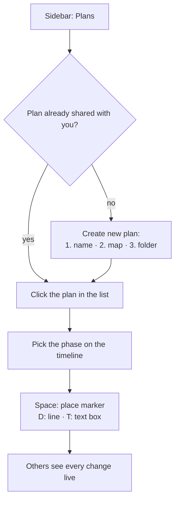
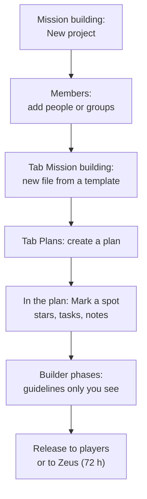
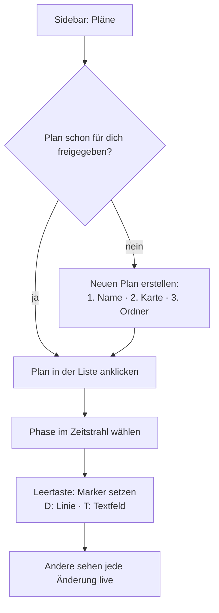
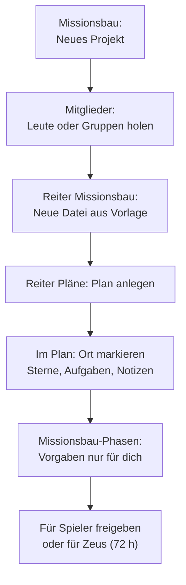

# SIDC – C2 — Getting started

**What is this page about?** Your first ten minutes in C2 — one path for **players**, one for **mission builders**, one for **admins**. **For whom?** New users. Each step links to the page with the details. Overview: [SIDC – C2](SIDC-C2-Command-Control).

## 1. For everyone: log in and find your way

1. Open the C2 address in the browser and log in (local account or *Sign in with OIDC*, if your server offers it).
2. The **sidebar** on the left: **Plans** · **Mission building** (projects) · **Chat** · **Trash**; mission builders also see **Libraries → ORBAT library**, admins **Administration**.
3. Top right: theme (dark / light / system) and language (DE / EN). The **gear** (Settings) holds keyboard shortcuts, marker display, notifications and API tokens.

## 2. Players: your first plan

1. **Open a plan:** sidebar **Plans** → click a plan. Plans shared with you appear there; plans of projects appear under **Projects → project name → plan**.
2. **Create one** (needs *may create plans*): **Create new plan** → *1. Plan name* → *2. Map* (cannot be changed later) → *3. Location (folder)* → **Create plan** (or **Create + set access**).
3. **Pick a phase** on the timeline at the top. New elements land in the **active phase**.
4. **Plan on the map** with the toolbar on the left (only with edit rights):

   | Key | Tool |
   |---|---|
   | `W` | Pan the map (click a marker = edit) |
   | `Space` | Place marker: click the position, then choose the symbol |
   | `D` | Draw line (click points, double‑click / green tick = done) |
   | `T` | Text box (Markdown) |
   | `A` | Point — your cursor appears for everyone |
   | `Q` / `E` | Undo / redo |

5. **Find something:** magnifier or `Ctrl+F` / `/`.
6. **Help:** the **?** button shows all keys (they are rebindable in the gear).

More: [Map & tools](SIDC-C2-Map-Tools) · [Workflows](SIDC-C2-Workflows).

## 3. Mission builders: your first mission

1. Sidebar **Mission building** → **New project** → name and description → **Create project**. You are the owner.
2. **Members** tab: add users or groups as *Viewer* or *Editor*.
3. **Mission building** tab: **New document** (dialog *New file*) with a template (mission concept, 5‑paragraph order, briefing, character, faction, place, scene).
4. **Plans** tab: create a plan (it keeps its own *Access / sharing*).
5. In the plan use **Mark a spot** (map pin with star) to tie places to tasks, sticky notes or directory entries.
6. Put guidelines into **builder phases** (lower timeline lane) and release them when ready.

Step by step: [Workflows → build a mission](SIDC-C2-Workflows) · project tabs: [Projects](SIDC-C2-Projects) · who sees what: [Roles & visibility](SIDC-C2-Roles-Visibility).

## 4. Zeus: during the mission

1. The admin ticks **Zeus** on your user or group.
2. In the plan switch the timeline view to **Zeus**. Player content is read‑only for you.
3. Builder phases released to Zeus appear in the lower lane — you may edit there. Individually released pink notes/stars are view‑only.

Details: [Workflows → work as Zeus](SIDC-C2-Workflows).

## 5. Admins: set up the server

1. Deploy the Docker stack and log in with `BOOTSTRAP_ADMIN_USER` / `BOOTSTRAP_ADMIN_PASSWORD`.
2. **Administration → Settings:** upload the SIDC catalogs and import at least one **map package**.
3. **Users & groups:** create users/groups, tick *may create plans*, *Mission builder*, *Zeus*.

Details: [Admin & install](SIDC-C2-Admin-Install).

---

# SIDC – C2 — Erste Schritte

**Worum geht's?** Deine ersten zehn Minuten in C2 — ein Weg für **Spieler**, einer für den **Missionsbau**, einer für **Admins**. **Für wen?** Neue Nutzer. Jeder Schritt verweist auf die Seite mit den Details. Überblick: [SIDC – C2](SIDC-C2-Command-Control).

## 1. Für alle: anmelden und zurechtfinden

1. C2-Adresse im Browser öffnen und anmelden (lokales Konto oder *Mit OIDC anmelden*, falls der Server das anbietet).
2. Die **Sidebar** links: **Pläne** · **Missionsbau** (Projekte) · **Chat** · **Papierkorb**; Missionsbauer sehen zusätzlich **Bibliotheken → ORBAT-Bibliothek**, Admins **Administration**.
3. Oben rechts: Farbschema (Dunkel / Hell / System) und Sprache (DE / EN). Im **Zahnrad** (Einstellungen) liegen Tastenkürzel, Marker-Anzeige, Benachrichtigungen und API-Tokens.

## 2. Spieler: dein erster Plan

1. **Plan öffnen:** Sidebar **Pläne** → Plan anklicken. Für dich freigegebene Pläne stehen dort; Pläne aus Projekten unter **Projekte → Projektname → Plan**.
2. **Neu anlegen** (braucht *darf Pläne erstellen*): **Neuen Plan erstellen** → *1. Name des Plans* → *2. Karte* (später nicht änderbar) → *3. Ablageort (Ordner)* → **Plan erstellen** (oder **Erstellen + Zugriff festlegen**).
3. **Phase wählen** im Zeitstrahl oben. Neue Elemente landen in der **aktiven Phase**.
4. **Auf der Karte planen** mit der Werkzeugleiste links (nur mit Bearbeitungsrecht):

   | Taste | Werkzeug |
   |---|---|
   | `W` | Karte bewegen (Marker anklicken = bearbeiten) |
   | `Leertaste` | Marker setzen: Position klicken, dann Symbol wählen |
   | `D` | Linie zeichnen (Punkte klicken, Doppelklick / grüner Haken = fertig) |
   | `T` | Textfeld (Markdown) |
   | `A` | Zeigen — dein Cursor erscheint bei allen |
   | `Q` / `E` | Rückgängig / Wiederholen |

5. **Etwas finden:** Lupe oder `Strg+F` / `/`.
6. **Hilfe:** der Knopf **?** zeigt alle Tasten (im Zahnrad umbelegbar).

Mehr: [Karte & Werkzeuge](SIDC-C2-Map-Tools) · [Abläufe](SIDC-C2-Workflows).

## 3. Missionsbau: deine erste Mission

1. Sidebar **Missionsbau** → **Neues Projekt** → Name und Beschreibung → **Projekt anlegen**. Du bist Owner.
2. Reiter **Mitglieder**: Nutzer oder Gruppen als *Betrachter* oder *Bearbeiter* aufnehmen.
3. Reiter **Missionsbau**: **Neues Dokument** (Fenster *Neue Datei*) mit Vorlage (Missionskonzept, Befehl 5-Absatz, Briefing, Charakter, Fraktion, Ort, Szene).
4. Reiter **Pläne**: Plan anlegen (er behält seine eigene *Zugriff / Freigaben*).
5. Im Plan mit **Ort markieren** (Kartennadel mit Stern) Orte mit Aufgaben, Haftnotizen oder Verzeichnis-Einträgen verbinden.
6. Vorgaben in **Missionsbau-Phasen** (untere Spur im Zeitstrahl) legen und freigeben, wenn sie fertig sind.

Schritt für Schritt: [Abläufe → Mission bauen](SIDC-C2-Workflows) · Projekt-Reiter: [Projekte](SIDC-C2-Projects) · wer sieht was: [Rollen & Sichtbarkeit](SIDC-C2-Roles-Visibility).

## 4. Zeus: während der Mission

1. Der Admin setzt das Häkchen **Zeus** an deinem Nutzer oder deiner Gruppe.
2. Im Plan die Ansicht im Zeitstrahl auf **Zeus** stellen. Spieler-Inhalte siehst du nur zum Ansehen.
3. Für Zeus freigegebene Missionsbau-Phasen erscheinen in der unteren Spur — dort darfst du bearbeiten. Einzeln freigegebene pinke Notizen/Sterne siehst du nur.

Details: [Abläufe → als Zeus arbeiten](SIDC-C2-Workflows).

## 5. Admins: Server einrichten

1. Docker-Stack deployen und mit `BOOTSTRAP_ADMIN_USER` / `BOOTSTRAP_ADMIN_PASSWORD` anmelden.
2. **Administration → Einstellungen:** SIDC-Kataloge hochladen und mindestens ein **Kartenpaket** importieren.
3. **Benutzer & Gruppen:** Nutzer/Gruppen anlegen, *darf Pläne erstellen*, *Missionsbau*, *Zeus* ankreuzen.

Details: [Admin & Installation](SIDC-C2-Admin-Install).
