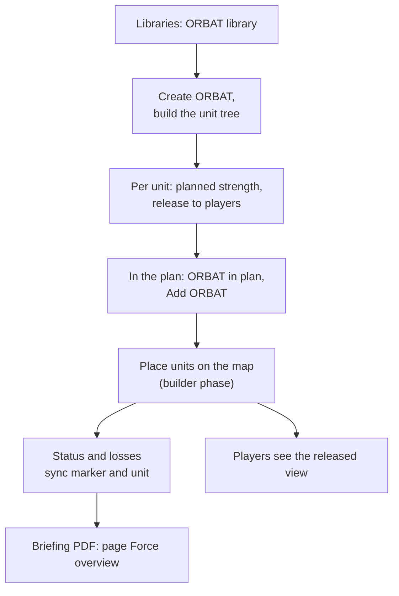
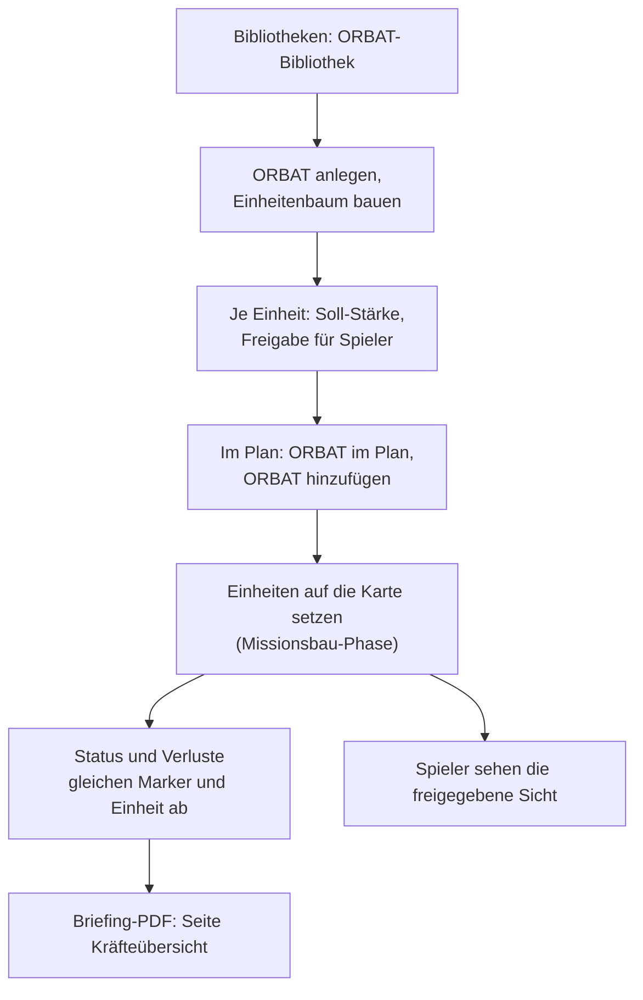

# SIDC – C2 — ORBAT

**What is this page about?** The **ORBAT library**: order‑of‑battle trees with planned and current strength, status sync with markers on the map, and how much of an (enemy) force players get to see. **For whom?** Mission builders who prepare forces; players see the released view in plans. Overview: [SIDC – C2](SIDC-C2-Command-Control).

## 1. Idea in short

- An **ORBAT** is a global unit tree (e.g. company → platoons → squads) with one affiliation. It is **timeless**: losses are tracked through status and strength, not through versions.
- The same ORBAT can be active in **several plans** — strength and status are shared.
- Units can be placed on the map as markers; marker and unit stay linked (status, losses).
- Per unit you decide what players may see (existence, type, strength) — ideal for reconnaissance pictures of the enemy.

## 2. ORBAT library

Sidebar **Libraries → ORBAT library** (mission builders only).

| Action | How |
|---|---|
| New ORBAT | name + affiliation: *Friend (BLUFOR)*, *Hostile (OPFOR)*, *Neutral (GREENFOR/INDFOR/civilian)*, *Unknown* |
| Units | *＋ Root unit*, *Sub‑unit*, *Clone unit (with sub‑units)*, *Edit unit*, delete (with sub‑units) |
| Tree | org chart top‑down; *Expand/collapse one level* or the whole sub‑tree; drag & drop to re‑attach |
| Symbol | *Choose symbol …* (marker builder) or *SIDC code …* |
| Sharing | *ORBAT sharing*: users/groups with *Read* or *Edit*; checkboxes *place* / *move* for the map link |

The affiliation sets the identity digit of **all** unit SIDCs and linked markers. Deleting an ORBAT: creator or admin.

## 3. Strength and status

| Field | Meaning |
|---|---|
| *Planned strength* (maximum strength) | target strength, free value |
| *Current strength* | actual strength, freely editable (+/−) |
| *Strength of this marker* | units represented by one linked marker |
| *Status* | *operational* / *damaged* / *destroyed* = SIDC status digit 6 |
| *Total strength* | sum over the leaf units (shown in library and plan) |

- **Status sync in both directions:** change a marker's status → the linked unit takes the worst status; change a unit's status → all linked markers get the SIDC status digit.
- **Losses:** if a linked marker becomes *destroyed*, the unit's current strength drops by the marker's strength; *revived* raises it again.
- Destroyed units/markers stay visible (semi‑transparent / greyed), they do not disappear. Display e.g. "10 / 14".

## 4. ORBAT in a plan

1. In the plan: toolbar button **ORBAT in plan** → pick an ORBAT → **Add ORBAT** (mission builder with access).
2. From then on **all players of the plan** see the ORBAT (read‑only): an **own‑side** ORBAT (affiliation *Friend*, e.g. BLUFOR) **completely**, an enemy / neutral / unknown ORBAT only in its **released** view (see 5). Mission builders see everything.
3. Expand the tree and use **Place on map** on a unit → a marker with the unit's SIDC is placed and linked. Alternatively link an existing marker in the marker editor via **ORBAT node** (mission builders).
4. A unit can have several markers (e.g. three platoons under one node).
5. Who may place or move ORBAT markers is set **per ORBAT** (*place* / *move*), not by the plan ACL. Players may not move or place enemy markers.

## 5. Releasing to players

The release settings only matter for **enemy, neutral and unknown** ORBATs — players always see their own side (*Friend*) in full.

Per unit, freely combinable:

| *visible to players* | *show type/symbol* | *released strength* | Players see |
|---|---|---|---|
| off | – | – | nothing |
| on | off | strength hidden | "enemy forces of unknown type/strength" (existence only) |
| on | on | strength hidden | symbol type, strength unknown |
| on | on | e.g. 50 % (default) | symbol type + about 50 % of the planned strength |
| on | on | 100 % | full view |

Markers of released units in a builder phase appear for players on the paired player phase: if the type is hidden reduced to a generic hostile symbol, without texts, locked and semi‑transparent. This also applies to public links. Known limit: live movement of such a marker reaches players only at the next load.

## 6. Briefing

The **Briefing PDF** gets an extra page **Force overview** as a rendered tree — only units that have a marker on the map. Builder briefing: full state; player briefing: released view.

---

# SIDC – C2 — ORBAT

**Worum geht's?** Die **ORBAT-Bibliothek**: Gliederungsbäume mit Soll- und Ist-Stärke, Status-Abgleich mit Markern auf der Karte und wie viel Spieler von einer (feindlichen) Kraft sehen. **Für wen?** Missionsbauer, die Kräfte vorbereiten; Spieler sehen in Plänen die freigegebene Sicht. Überblick: [SIDC – C2](SIDC-C2-Command-Control).

## 1. Idee in Kürze

- Ein **ORBAT** ist ein globaler Einheitenbaum (z. B. Kompanie → Züge → Gruppen) mit einer Zugehörigkeit. Er ist **zeitlos**: Verluste stecken in Status und Stärke, nicht in Versionen.
- Derselbe ORBAT kann in **mehreren Plänen** aktiv sein — Stärke und Status sind geteilt.
- Einheiten lassen sich als Marker auf die Karte setzen; Marker und Einheit bleiben verknüpft (Status, Verluste).
- Pro Einheit legst du fest, was Spieler sehen dürfen (Existenz, Typ, Stärke) — ideal für Aufklärungsbilder vom Feind.

## 2. ORBAT-Bibliothek

Sidebar **Bibliotheken → ORBAT-Bibliothek** (nur Missionsbau).

| Aktion | So geht's |
|---|---|
| Neuer ORBAT | Name + Zugehörigkeit: *Freund (BLUFOR)*, *Feind (OPFOR)*, *Neutral (GREENFOR/INDFOR/Zivil)*, *Unbekannt* |
| Einheiten | *＋ Wurzel-Einheit*, *Unter-Einheit*, *Einheit klonen (mit Untereinheiten)*, *Einheit bearbeiten*, löschen (mit Unter-Einheiten) |
| Baum | Organigramm von oben nach unten; *Eine Ebene auf-/zuklappen* oder die ganze Untergliederung; Drag & Drop zum Umhängen |
| Symbol | *Symbol wählen …* (Marker-Baukasten) oder *SIDC-Code …* |
| Freigaben | *ORBAT-Freigaben*: Nutzer/Gruppen mit *Lesen* oder *Bearbeiten*; Häkchen *setzen* / *verschieben* für die Karten-Verknüpfung |

Die Zugehörigkeit setzt die Identitätsstelle **aller** Einheiten-SIDCs und verknüpften Marker. ORBAT löschen: Ersteller oder Admin.

## 3. Stärke und Status

| Feld | Bedeutung |
|---|---|
| *Soll-Stärke* (Maximalstärke) | Zielstärke, freier Wert |
| *Ist-Stärke* | tatsächliche Stärke, frei änderbar (+/−) |
| *Stärke dieses Markers* | Einheiten, für die ein verknüpfter Marker steht |
| *Status* | *einsatzbereit* / *beschädigt* / *zerstört* = SIDC-Statusstelle 6 |
| *Gesamtstärke* | Summe über die Blatt-Einheiten (in Bibliothek und Plan) |

- **Status-Abgleich in beide Richtungen:** Marker-Status ändern → die verknüpfte Einheit übernimmt den schlimmsten Status; Einheiten-Status ändern → alle verknüpften Marker bekommen die SIDC-Statusstelle.
- **Verluste:** wird ein verknüpfter Marker *zerstört*, sinkt die Ist-Stärke der Einheit um die Stärke des Markers; „wiederbelebt" hebt sie wieder.
- Zerstörte Einheiten/Marker bleiben sichtbar (halbtransparent / grau), sie verschwinden nicht. Anzeige z. B. „10 / 14".

## 4. ORBAT im Plan

1. Im Plan: Werkzeugleisten-Knopf **ORBAT im Plan** → ORBAT wählen → **ORBAT hinzufügen** (Missionsbauer mit Zugriff).
2. Ab dann sehen **alle Spieler des Plans** den ORBAT (nur lesen): einen ORBAT der **eigenen Seite** (Zugehörigkeit *Freund*, z. B. BLUFOR) **vollständig**, einen feindlichen / neutralen / unbekannten ORBAT nur in seiner **freigegebenen** Sicht (siehe 5). Missionsbauer sehen alles.
3. Baum aufklappen und bei einer Einheit **Auf Karte platzieren** → ein Marker mit dem SIDC der Einheit wird gesetzt und verknüpft. Alternativ einen bestehenden Marker im Marker-Editor über **ORBAT-Knoten** verknüpfen (Missionsbau).
4. Eine Einheit kann mehrere Marker haben (z. B. drei Züge unter einem Knoten).
5. Wer ORBAT-Marker setzen oder verschieben darf, regelt **jeder ORBAT** selbst (*setzen* / *verschieben*), nicht die Plan-ACL. Spieler dürfen Feind-Marker weder verschieben noch setzen.

## 5. Freigabe für Spieler

Die Freigabe-Einstellungen gelten nur für **feindliche, neutrale und unbekannte** ORBATs — die eigene Seite (*Freund*) sehen Spieler immer vollständig.

Pro Einheit frei kombinierbar:

| *für Spieler sichtbar* | *Typ/Symbol zeigen* | *freigegebene Stärke* | Spieler sehen |
|---|---|---|---|
| aus | – | – | nichts |
| an | aus | Stärke verborgen | „Feindkräfte unbekannter Art/Stärke" (nur Existenz) |
| an | an | Stärke verborgen | Symboltyp, Stärke unbekannt |
| an | an | z. B. 50 % (Standard) | Symboltyp + etwa 50 % der Soll-Stärke |
| an | an | 100 % | volle Sicht |

Marker freigegebener Einheiten in einer Missionsbau-Phase erscheinen bei Spielern auf der gepaarten Spieler-Phase: bei verborgenem Typ auf ein allgemeines Feind-Symbol reduziert, ohne Texte, gesperrt und halbtransparent. Das gilt auch für öffentliche Links. Bekannte Grenze: Live-Bewegungen eines solchen Markers sehen Spieler erst beim nächsten Laden.

## 6. Briefing

Das **Briefing-PDF** bekommt eine Zusatzseite **Kräfteübersicht** als gerenderten Baum — nur Einheiten, die einen Marker auf der Karte haben. Missionsbau-Briefing: voller Stand; Spieler-Briefing: freigegebene Sicht.
