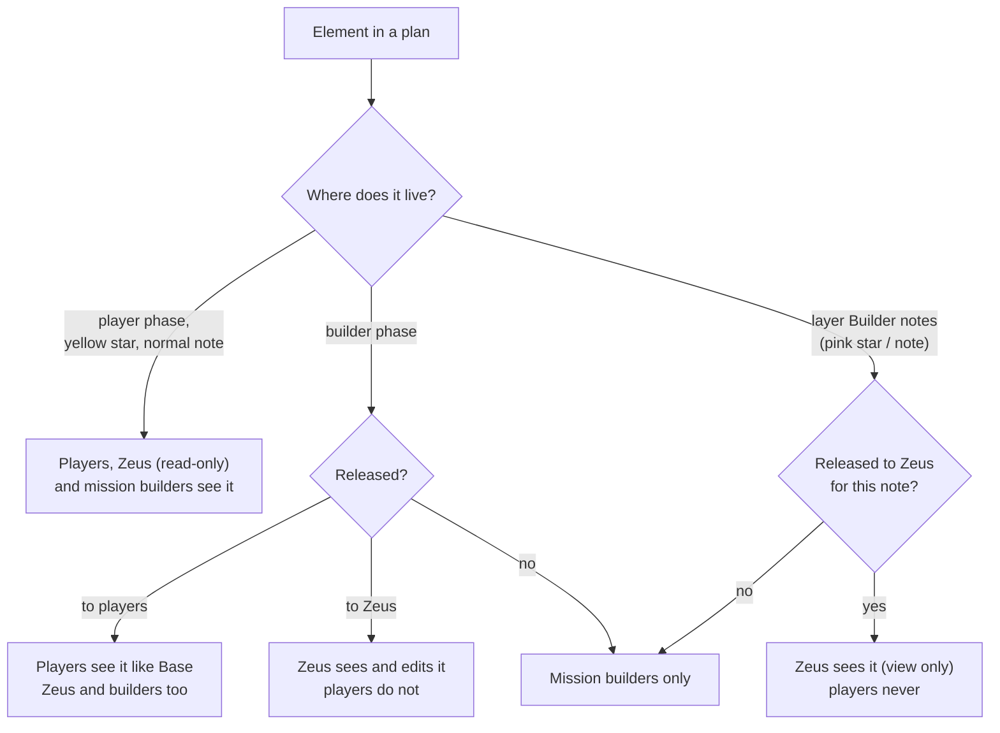
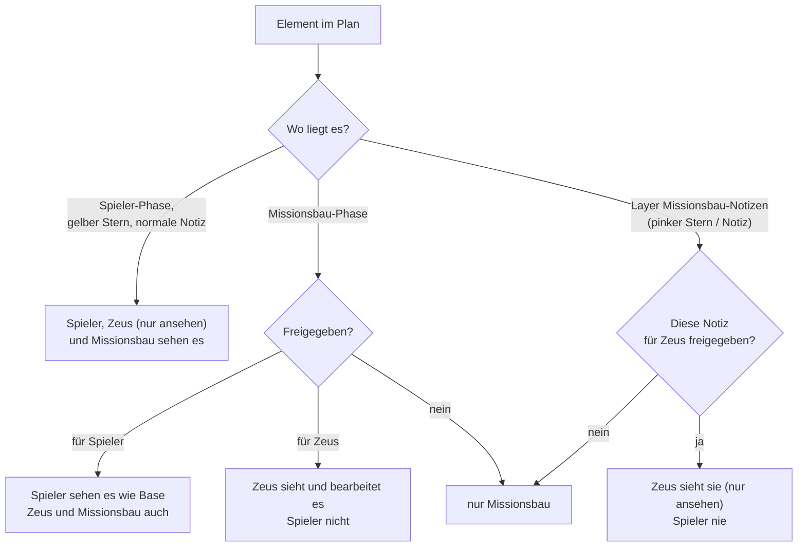

# SIDC – C2 — Roles & visibility

**What is this page about?** Who may do what in C2 and who sees which content: the three groups (players, mission builders, Zeus), plan and project permissions, releases for players and Zeus, the *Builder notes* layer and public links. **For whom?** Mission builders and admins who hand out access — and anyone wondering why they can (not) see something. Overview: [SIDC – C2](SIDC-C2-Command-Control).

All permissions are checked **by the server on every action** (REST and WebSocket); hidden content never leaves the server.

## 1. Two levels of permissions

| Level | Where set | What it controls |
|---|---|---|
| **Global role** `admin` / `user` | admin area → *Users & groups* | admin has full access and the admin area; unknown OIDC users become `user` |
| **may create plans** | checkbox on user or group | may create plans and plan folders, may clone plans |
| **Mission builder** / **Zeus** | checkbox on user or group | the group (see 2). Without a checkbox you are a player. Admin counts as mission builder |
| **Plan ACL** | per plan → *Access / sharing* | who may open / edit a plan (see 3) |
| **Project membership** | per project → *Members* | files, tasks, whiteboard, feedback of a project (see 4) — **not** plan access |
| **ORBAT ACL** | per ORBAT → *ORBAT sharing* | who may read/edit an ORBAT and place/move its markers (see [ORBAT](SIDC-C2-ORBAT)) |

Rights given to a **group** are inherited by all its members. `DEFAULT_USER_GROUP` in `.env` puts new users into a group automatically.

## 2. The three groups

| Group | Does | Sees |
|---|---|---|
| **Players** (default) | plan on the map themselves: markers, lines, text boxes, phases | everything for players — plus what mission building explicitly releases to them |
| **Mission builder** | sets the guidelines, plans long‑term (projects, files, tasks, builder phases) and hands work to individuals | **everything** |
| **Zeus** | runs the mission in game | everything for players (read‑only) + the released parts of mission building |

### Who sees what in a plan

| Content | Players | Zeus | Mission builder |
|---|---|---|---|
| Player phases and their markers/lines/text boxes | ✔ | ✔ (read‑only) | ✔ |
| Builder phase | – | only if **released to Zeus** (Zeus may edit there) | ✔ |
| Builder phase **released to players** | ✔ (looks like Base) | ✔ | ✔ |
| **Builder notes & pink stars** (layer) | – | only individually **released to Zeus** ones (view only) | ✔ |
| Yellow stars / normal notes | ✔ | ✔ | ✔ |
| Project area *Mission building* (files, images) | – | – | ✔ |

### The view switch (*acting as*)

On the timeline mission builders switch the view: **Player** (preview like a player — only your own stars/notes stay visible) · **Builder** · **Zeus**. Zeus users switch to **Zeus**. In the Zeus view nothing can be placed in player phases. The slider *Opacity player ↔ builder* sets how strongly the other side shows through.

## 3. Plan permissions (ACL)

Open a plan → top right **Access / sharing**. Add users **or** groups with a role:

| Role (UI) | API | May |
|---|---|---|
| **Read** | `viewer` | open the plan, see markers/drawings, read notes & versions, use *Point* |
| **Edit** | `editor` | + the four individual rights **place · move · delete · draw**, rename the plan, save versions |
| **Full (owner)** | `owner` | everything + manage access, public links, restore versions, delete; can override marker locks |

- At least one owner is required. Whoever creates a plan becomes owner.
- **Clone** needs read access to the source plan **and** *may create plans*.
- **Marker lock:** a locked marker can only be changed/deleted by the plan owner; whoever may *move* may lock and unlock.
- Plans **inside a project** keep their own ACL — the project role gives **no** plan rights. Plan folders: create = *may create plans*; rename/move/delete = creator or admin.
- Removing a right or deactivating a user also cuts open WebSocket connections.

## 4. Project permissions

Projects live in the sidebar under **Mission building**. Only **admins and mission builders** create projects; the creator becomes owner.

| Project role | May |
|---|---|
| **Viewer** | read everything; comment, write in task discussions, submit feedback |
| **Editor** | + write files, tasks, whiteboard, milestones, project status; create plans in the project |
| **Owner** | + manage members, rename, archive, delete; manage the external feedback link |

- The tab **Mission building** (files and images) is visible to **mission builders only** — others do not even learn it exists.
- Archived projects are read‑only.
- Adding someone as an **editor** to a project is how you hand parts of the work to individuals — see [Workflows → hand a project to individuals](SIDC-C2-Workflows).

## 5. Releases

| Release | Where | Duration | Effect |
|---|---|---|---|
| **Release to players (acts like Base)** | builder phase → phase notes | permanent until unticked | content appears for players like the Base phase; the phase itself stays hidden; editing remains with mission building |
| **Release to Zeus** (phase) | builder phase → phase notes | **72 h** preselected; *Unlimited* button or own value (empty = unlimited) | Zeus sees the phase in the lower lane and may edit there |
| **Release to Zeus** (single note/star) | eye icon on a pink note/star (hover: *Release to Zeus (72 h)*) | 72 h; more options in the editor | Zeus sees this note (view only) |

Releases can be withdrawn at any time. **Expired releases disappear at the next load** (no push at expiry). Flowchart: [Workflows → release to Zeus](SIDC-C2-Workflows).

## 6. The layer *Builder notes & stars*

In project plans, mission builders choose **Visible to** for every text box and star: *Everyone (normal note)* → lives in a phase like any other element (yellow star) · *Mission builders only* → lies on the layer **Builder notes** (pink star).

- The layer is **a layer, not a phase**: independent of phases, not on the timeline, listed in the **Layers** menu as *Builder notes & stars*, where mission builders can hide or dim it.
- Players never see it; Zeus only individually released notes.
- Everyone else places normal notes in a phase.

## 7. Public links

Owner → **Access / sharing** → **Public link (view only)** → *Create link*. The link `#/p/<token>` opens the plan **without login**.

| Option | Meaning |
|---|---|
| Label (optional) | name in the list |
| *Point* (on by default) | link visitors can show their cursor |
| *Move marker* / *Edit* | optional extra rights for the link (moving, or editing markers, lines and notes) — off by default |
| *Builder* (mission builders only) | include builder phases (visitors then see them too) |
| Days (0 = unlimited) | expiry |
| Scope | *all phases* · *specific phases only* · *time window (plan date)* |

Without extra rights a link is read‑only: map, markers, drawings, notes (also star areas), places, contour/peak layers. *Revoke* invalidates the link immediately (open connections are closed). Live updates only reach a link within its scope and without internal user names.

---

# SIDC – C2 — Rollen & Sichtbarkeit

**Worum geht's?** Wer in C2 was darf und wer welche Inhalte sieht: die drei Gruppen (Spieler, Missionsbau, Zeus), Plan- und Projektrechte, Freigaben für Spieler und Zeus, der Layer *Missionsbau-Notizen* und öffentliche Links. **Für wen?** Missionsbauer und Admins, die Zugriffe vergeben — und alle, die wissen wollen, warum sie etwas (nicht) sehen. Überblick: [SIDC – C2](SIDC-C2-Command-Control).

Alle Rechte prüft **der Server bei jeder Aktion** (REST und WebSocket); verborgene Inhalte verlassen den Server nie.

## 1. Zwei Ebenen von Rechten

| Ebene | Wo gesetzt | Was sie steuert |
|---|---|---|
| **Globale Rolle** `admin` / `user` | Admin-Bereich → *Benutzer & Gruppen* | Admin hat Vollzugriff und den Admin-Bereich; unbekannte OIDC-Nutzer werden `user` |
| **darf Pläne erstellen** | Häkchen an Nutzer oder Gruppe | Pläne und Plan-Ordner anlegen, Pläne klonen |
| **Missionsbau** / **Zeus** | Häkchen an Nutzer oder Gruppe | die Gruppe (siehe 2). Ohne Häkchen ist man Spieler. Admin zählt als Missionsbau |
| **Plan-ACL** | pro Plan → *Zugriff / Freigaben* | wer einen Plan öffnen / bearbeiten darf (siehe 3) |
| **Projekt-Mitgliedschaft** | pro Projekt → *Mitglieder* | Dateien, Aufgaben, Whiteboard, Feedback eines Projekts (siehe 4) — **nicht** der Plan-Zugriff |
| **ORBAT-ACL** | pro ORBAT → *ORBAT-Freigaben* | wer einen ORBAT lesen/bearbeiten und dessen Marker setzen/verschieben darf (siehe [ORBAT](SIDC-C2-ORBAT)) |

Rechte einer **Gruppe** erben alle Mitglieder. `DEFAULT_USER_GROUP` in der `.env` ordnet neue Nutzer automatisch einer Gruppe zu.

## 2. Die drei Gruppen

| Gruppe | Was sie tut | Was sie sieht |
|---|---|---|
| **Spieler** (Standard) | planen selbst auf der Karte: Marker, Linien, Textfelder, Phasen | alles für Spieler – plus das, was der Missionsbau ihnen ausdrücklich freigibt |
| **Missionsbau** | macht die Vorgaben, plant langfristig (Projekte, Dateien, Aufgaben, Missionsbau-Phasen) und verteilt Arbeit an einzelne Leute | **alles** |
| **Zeus** | leitet die Mission im Spiel | alles für Spieler (nur ansehen) + die freigegebenen Teile des Missionsbaus |

### Wer sieht was im Plan

| Inhalt | Spieler | Zeus | Missionsbau |
|---|---|---|---|
| Spieler-Phasen und ihre Marker/Linien/Textfelder | ✔ | ✔ (nur ansehen) | ✔ |
| Missionsbau-Phase | – | nur wenn **für Zeus freigegeben** (Zeus darf dort bearbeiten) | ✔ |
| Missionsbau-Phase **für Spieler freigegeben** | ✔ (erscheint wie Base) | ✔ | ✔ |
| **Missionsbau-Notizen & pinke Sterne** (Layer) | – | nur einzeln **für Zeus freigegebene** (nur ansehen) | ✔ |
| Gelbe Sterne / normale Notizen | ✔ | ✔ | ✔ |
| Projekt-Bereich *Missionsbau* (Dateien, Bilder) | – | – | ✔ |

### Der Ansichts-Umschalter (*wirke als*)

Im Zeitstrahl schaltet der Missionsbau die Ansicht um: **Spieler** (Vorschau wie ein Spieler — nur die eigenen Sterne/Notizen bleiben sichtbar) · **Missionsbau** · **Zeus**. Zeus-Nutzer schalten auf **Zeus**. In der Zeus-Ansicht lässt sich in Spieler-Phasen nichts setzen. Der Regler *Transparenz Spieler ↔ Missionsbau* bestimmt, wie stark die jeweils andere Seite durchscheint.

## 3. Plan-Rechte (ACL)

Plan öffnen → oben rechts **Zugriff / Freigaben**. Nutzer **oder** Gruppen mit einer Rolle eintragen:

| Rolle (UI) | API | Darf |
|---|---|---|
| **Lesen** | `viewer` | Plan öffnen, Marker/Zeichnungen sehen, Notizen & Versionen lesen, *Zeigen* |
| **Bearbeiten** | `editor` | + die vier Einzelrechte **setzen · bewegen · löschen · malen**, Plan umbenennen, Versionen sichern |
| **Voll (owner)** | `owner` | alles + Zugriff verwalten, öffentliche Links, Versionen wiederherstellen, löschen; kann Marker-Sperren übergehen |

- Mindestens ein Owner ist Pflicht. Wer einen Plan anlegt, wird Owner.
- **Klonen** braucht Lesezugriff auf den Quell-Plan **und** *darf Pläne erstellen*.
- **Marker-Sperre:** einen gesperrten Marker ändert/löscht nur der Plan-Owner; sperren und entsperren darf, wer *bewegen* darf.
- Pläne **in einem Projekt** behalten ihre eigene ACL — die Projektrolle gibt **keine** Planrechte. Plan-Ordner: anlegen = *darf Pläne erstellen*; umbenennen/verschieben/löschen = Ersteller oder Admin.
- Wer ein Recht verliert oder deaktiviert wird, verliert auch offene WebSocket-Verbindungen.

## 4. Projekt-Rechte

Projekte liegen in der Sidebar unter **Missionsbau**. Projekte anlegen dürfen nur **Admins und Missionsbauer**; der Ersteller wird Owner.

| Projektrolle | Darf |
|---|---|
| **Betrachter** | alles lesen; kommentieren, in Aufgaben-Diskussionen schreiben, Feedback abgeben |
| **Bearbeiter** | + Dateien, Aufgaben, Whiteboard, Meilensteine, Projektstatus schreiben; Pläne im Projekt anlegen |
| **Owner** | + Mitglieder verwalten, umbenennen, archivieren, löschen; externen Feedback-Link verwalten |

- Der Reiter **Missionsbau** (Dateien und Bilder) ist **nur für Missionsbauer** sichtbar — andere erfahren nicht einmal, dass es ihn gibt.
- Archivierte Projekte sind schreibgeschützt.
- Jemanden als **Bearbeiter** ins Projekt holen ist der Weg, Teile der Arbeit an Einzelne auszulagern — siehe [Abläufe → Projekt an Einzelne auslagern](SIDC-C2-Workflows).

## 5. Freigaben

| Freigabe | Wo | Dauer | Wirkung |
|---|---|---|---|
| **Für Spieler freigeben (wirkt wie Base)** | Missionsbau-Phase → Phasen-Notizen | dauerhaft, bis das Häkchen weg ist | Inhalt erscheint bei Spielern wie die Base-Phase; die Phase selbst bleibt verborgen; Bearbeiten bleibt beim Missionsbau |
| **Für Zeus freigeben** (Phase) | Missionsbau-Phase → Phasen-Notizen | **72 h** vorausgewählt; Knopf *Unbegrenzt* oder eigener Wert (leer = unbegrenzt) | Zeus sieht die Phase in der unteren Spur und darf dort bearbeiten |
| **Für Zeus freigeben** (einzelne Notiz/Stern) | Auge an der pinken Notiz/am Stern (Hover: *Für Zeus freigeben (72 h)*) | 72 h; weitere Optionen im Editor | Zeus sieht diese Notiz (nur ansehen) |

Freigaben lassen sich jederzeit zurücknehmen. **Abgelaufene Freigaben verschwinden beim nächsten Laden** (kein Push beim Ablauf). Ablaufdiagramm: [Abläufe → an Zeus freigeben](SIDC-C2-Workflows).

## 6. Der Layer *Missionsbau-Notizen & Sterne*

In Projekt-Plänen wählen Missionsbauer bei jedem Textfeld und Stern **Sichtbar für**: *Alle (normale Notiz)* → liegt wie jedes Element in einer Phase (gelber Stern) · *Nur Missionsbau* → liegt auf dem Layer **Missionsbau-Notizen** (pinker Stern).

- Der Layer ist **ein Layer, keine Phase**: phasenunabhängig, nicht im Zeitstrahl, im Menü **Layer** als *Missionsbau-Notizen & Sterne*, wo der Missionsbau ihn aus- oder abblenden kann.
- Spieler sehen ihn nie; Zeus nur einzeln freigegebene Notizen.
- Alle anderen setzen normale Notizen in einer Phase.

## 7. Öffentliche Links

Owner → **Zugriff / Freigaben** → **Öffentlicher Link (nur ansehen)** → *Link erzeugen*. Der Link `#/p/<token>` öffnet den Plan **ohne Login**.

| Option | Bedeutung |
|---|---|
| Bezeichnung (optional) | Name in der Liste |
| *Zeigen* (standardmäßig an) | Besucher des Links können ihren Cursor zeigen |
| *Marker verschieben* / *Bearbeiten* | optionale Zusatzrechte für den Link (verschieben bzw. Marker, Linien und Notizen bearbeiten) — standardmäßig aus |
| *Missionsbau* (nur Missionsbauer) | Missionsbau-Phasen mit freigeben (Besucher sehen sie dann auch) |
| Tage (0 = unbegrenzt) | Ablauf |
| Eingrenzung | *alle Phasen* · *nur bestimmte Phasen* · *Zeitfenster (Plan-Datum)* |

Ohne Zusatzrechte ist ein Link nur lesend: Karte, Marker, Zeichnungen, Notizen (auch Stern-Bereiche), Orte, Höhenlinien/-punkte. *Widerrufen* macht den Link sofort ungültig (offene Verbindungen werden getrennt). Live-Updates erreichen einen Link nur im Umfang seiner Freigabe und ohne interne Nutzernamen.
