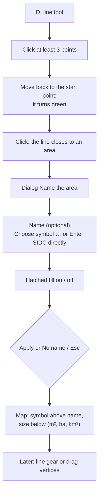
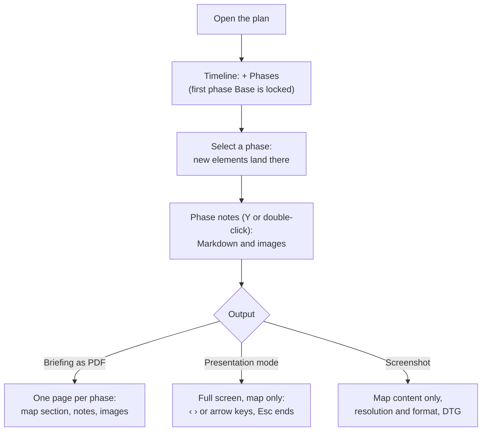
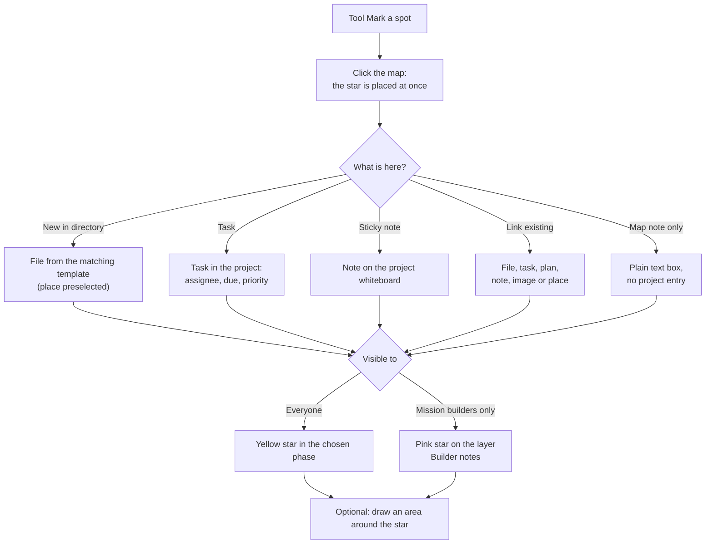
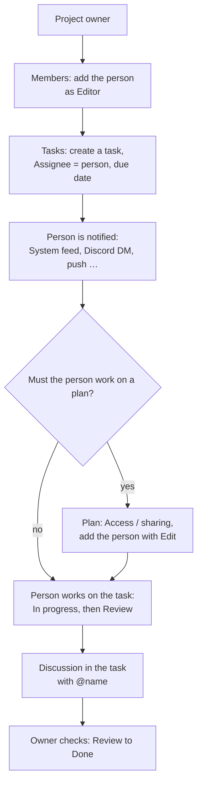
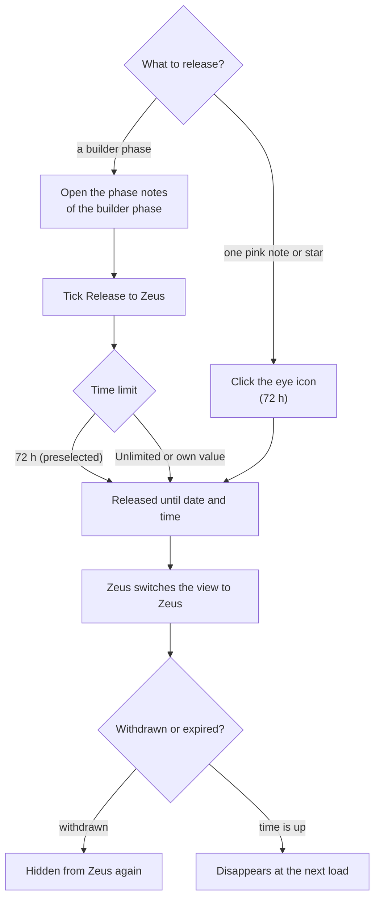
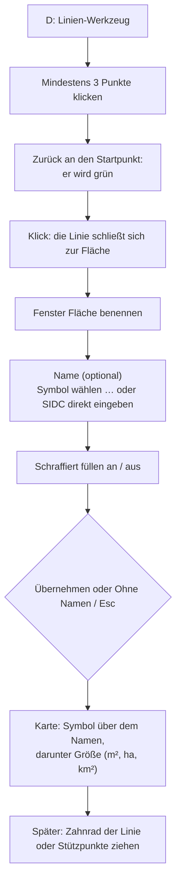
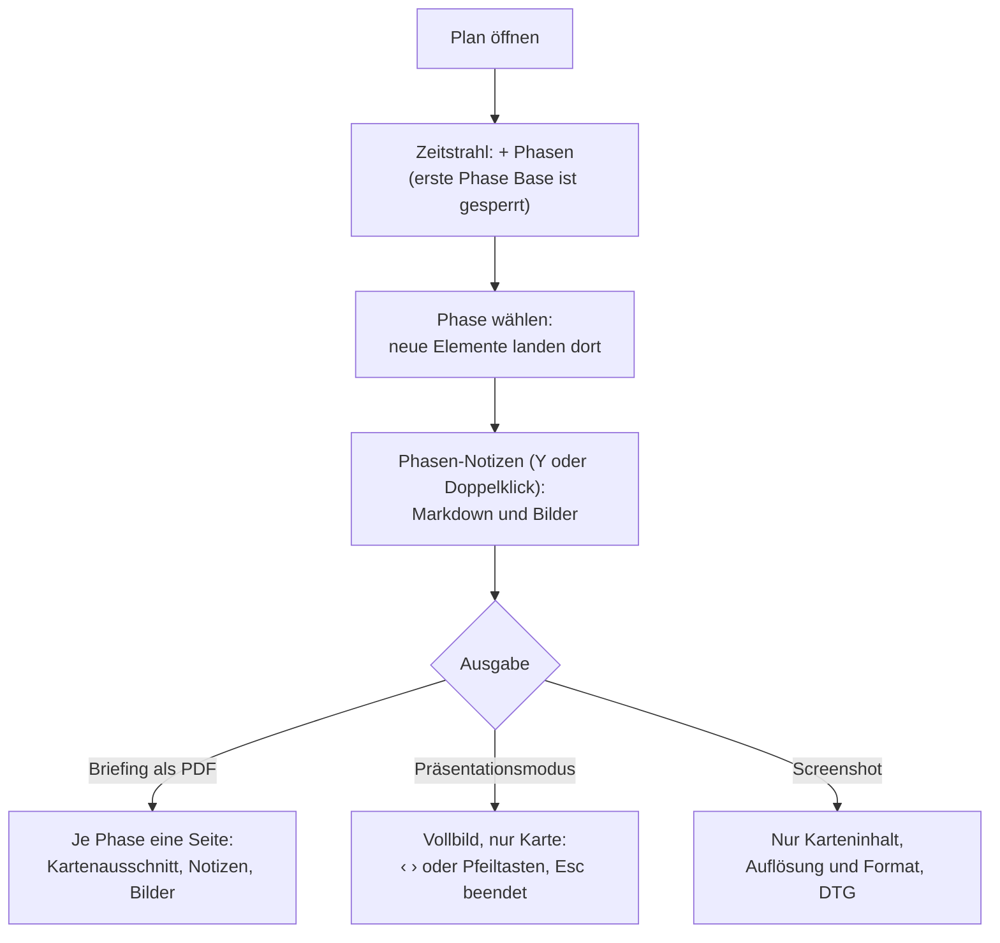
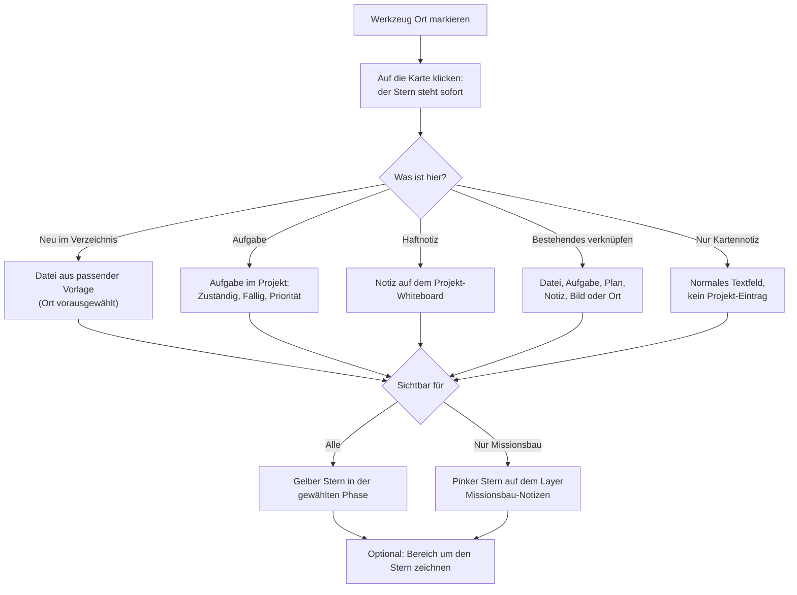
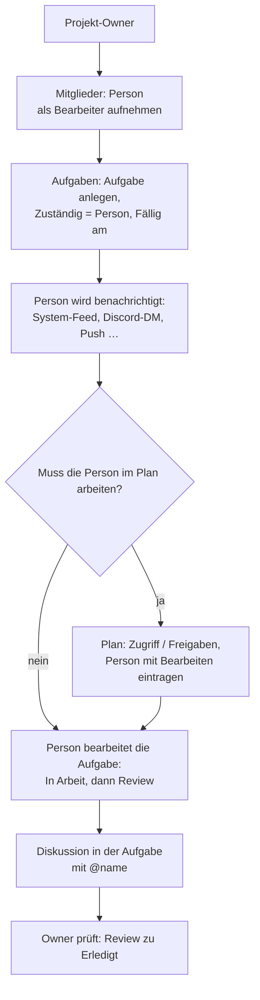
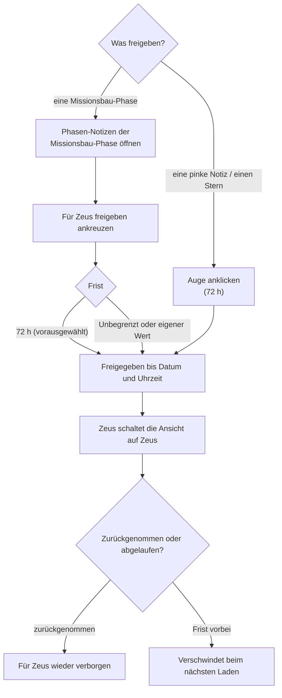

# SIDC – C2 — Workflows (step by step)

**What is this page about?** The typical tasks in C2 as short step lists with flowcharts — from "create a plan" to "release to Zeus". **For whom?** Players (sections 1–5, 9–10), mission builders (6–8) and Zeus (11). Keys are the defaults (rebindable in the gear, see [Map & tools](SIDC-C2-Map-Tools)); who may do what is on [Roles & visibility](SIDC-C2-Roles-Visibility).

## 1. Create a plan and share it

1. Sidebar **Plans** → card **Create new plan**: *1. Plan name* → *2. Map* (cannot be changed later) → *3. Location (folder)*.
2. **Create plan** opens it right away; **Create + set access** first asks who gets access.
3. In the plan top right **Access / sharing** (owner): add users or groups as **Read**, **Edit** (with the four rights *place · move · delete · draw*) or **Full (owner)**.
4. Optional: **Public link (view only)** — no login, with label, expiry in days, scope (phases or time window), revocable.

- **Folders:** drag plans and folders onto each other (drag & drop) or use **Move to…**. Deleting a folder moves its content one level up.
- **Clone:** copies the plan with phases, layers, markers and lines into a target folder, optionally with its sharing (*Copy sharing too*). Text boxes/stars are not copied; builder content is not copied for non‑mission‑builders.
- **Trash:** deleted plans go to **Trash** — *Restore* or *Delete permanently*.

## 2. Place and edit markers

1. `Space` (**Place marker**) → click the position → the marker selection opens.
2. Choose via **Quick menu** (affiliation → category → symbol), **Catalog** (search) or **Marker builder** (dropdowns, live preview, SIDC number input).
3. Optional: unit text, extra text, direction, colour, **Tactical layer** (default *Auto*), locked, timestamp, **Advanced (modifiers)**.
4. Line symbols repeat with every click until a **right‑click**.

**Edit:** hover a marker → quick buttons *Delete · Move · Edit*. Or click it in the *Pan* tool. The edit window holds texts, rotation, size, phase (also *More phases*), layer, lock, modifiers, **Clone**, **★ Favorite**. Favorites (`R`) place saved markers with one click. Copy / cut / paste: `C` / `X` / `V`.

## 3. Draw lines and named areas

**Line:** `D` → click points → **double‑click** or the **green tick** finishes; **right‑click / Esc discards** the running line. Colour, width, phase, *More phases* and layer are in the line menu.

**Named area:**

- Unit and point symbols are drawn above the name; symbols that cannot be drawn as a point symbol are dropped (name only).
- Later changes: click the area → gear (*Name*, *Symbol*, *Hatched fill*, *Closed area* on/off) or drag its vertices. Undo/redo works for lines too.
- Named areas are visible to everyone who sees the line's phase/layer, also on public links.

## 4. Phases, phase notes, briefing and presentation

1. **Phases:** on the timeline click = select, drag = move, drag the edges = duration. *+ Phases* adds one. `←` / `→` switch.
2. **Elements** belong to the active phase; in the edit window change the phase or add *More phases*. The slider *Visibility of other phases* sets how strongly other phases show through.
3. **Phase notes:** `Y` or double‑click a phase bar — Markdown with images, one tab per phase.
4. **Briefing PDF** (top bar): one page per phase with map section, phase notes and images; mission builders choose **Player** or **Builder** briefing. If ORBATs are linked, a page *Force overview* is added (see [ORBAT](SIDC-C2-ORBAT)).
5. **Presentation mode** (top bar): full screen without controls; a small bar with ‹ phase name › and *Exit (Esc)*; arrow keys or PageUp/PageDown change the phase.
6. **Screenshot** (camera): map content only, resolution (current, 1920×1080, 2560×1440, 3840×2160, custom) and format (PNG, JPEG, WebP), military DTG bottom left. The date/time field overrides "now".

- Deleting a player phase keeps its elements as "global" (always visible); deleting a builder phase deletes its content.

## 5. Search the plan

1. Magnifier in the top bar or `Ctrl+F` / `/`.
2. Type — it searches markers (label, extra text, symbol name), notes and stars (also linked places/titles), named lines/areas, map images, place names and phases. Case and umlauts don't matter (`mueller` = `müller` = `muller`).
3. Arrow keys + `Enter` or click: the map flies there and the hit lights up for ~3 s. Hits in another phase switch the phase; hits in a hidden layer show the layer again (both are marked in the list beforehand).
4. `Esc` clears / closes. Only finds what your current view (player / builder / Zeus) may show. Works read‑only and on phones.

## 6. Build a mission (mission builders)

1. **Project:** sidebar **Mission building** → **New project**. You are owner. **Members**: add people or groups (*Viewer* reads, *Editor* writes).
2. **Concept:** tab **Mission building** → **New document** → template (mission concept, order (5‑paragraph), briefing, character, faction, place, scene). Headings with a time (`## 06:30 Approach`, `## T+01:30 Enemy contact`) appear in the **Timeline** tab; **Directory** sorts files by type.
3. **Plan:** tab **Plans** → create a plan (or *Move existing plan here*). Plans keep their own *Access / sharing*.
4. **Mark spots:** in the plan the tool **Mark a spot** — see section 7.
5. **Distribute work:** tab **Tasks** (kanban *Open · In progress · Review · Done*) with assignee, due date, priority; questions go into the task's *Discussion* (`@name`, `@project`). See section 8.
6. **Guidelines in the plan:** builder phases (lower timeline lane) hold what only mission building should see. Switch the view at the top: **Player** · **Builder** · **Zeus**.
7. **Release:** builder phase → phase notes → *Release to players (acts like Base)* or *Release to Zeus* (section 9).
8. **Track progress:** **Overview** (open tasks per person, due items, milestones, project status *Draft → Review → Test → Release*), **Activity**, **Feedback**.

## 7. Mark a spot (stars)

Only for mission builders and only in plans that belong to a project.

1. Choose **Mark a spot** (map pin with star) and **click the map** — the star stands immediately (`Esc` cancels).
2. In the dialog **What is here?** choose:
   - **New in directory** — *Place* (preselected), *Character*, *Faction*, *Scene*, *Mission concept*, *Order (5‑paragraph)*, *Briefing* or *Other*: name and description become a file from the matching template in the *Mission building* area, sorted into the **Directory** at once and pointing to the plan.
   - **More:** **Task** (title, *What should happen here?*, *Assignee*, *Due*, *Priority*; linked to this plan) · **Sticky note** (lands on the whiteboard) · **Link existing** (pick a file, task, plan, note, image or place; optional label and description) · **Map note only**.
3. **Visible to:** *Everyone (normal note)* → yellow star in the chosen phase · *Mission builders only* (preselected) → pink star on the layer *Builder notes*.
4. **Create.** Creating something new needs **editor rights in the project**; otherwise the buttons are disabled and the dialog says why (e.g. not a project member, archived project).

**Area around the star:** tick *Then draw an area around the star* — or later the area button on the star (tooltip *Draw area*, for an existing area *Edit area (drag corners)*). Left clicks set corners; clicking the (green) start point closes the shape, which is hatched (fill 25 %, outline 50 %, star colour). An open line is kept with ✓, Enter or right‑click; Esc cancels. Later: click the area → drag corners, bar with *Done*, *Redraw area*, *Remove area*. The area moves with the star and follows its visibility; its size (area, or length for an open line) is shown under the star.

**On the map:** the linked targets are listed next to the star — a click opens them in a new tab; hovering shows the description. Above the star appear *Collapse · Zeus release · Edit · Delete*. In the project each target shows **Mentioned in …**, and **Directory → On the map** lists all stars and notes of all plans with a jump to the spot.

## 8. Hand a project (or parts of it) to individuals

1. **Members** tab → pick the user (or a group) → role **Editor** → *Add* → **Save**. The person gets "Added to a project".
2. **Tasks** tab → task with **Assignee** and **Due on**; optionally link a plan or document. The assignee is notified ("Assignment").
3. If the work happens on the map: give **plan access** separately (*Access / sharing* → *Edit*) — the project role gives no plan rights.
4. Files in the *Mission building* tab are only visible to **mission builders**; if the person must write files, the admin ticks *Mission builder* for them.
5. Follow up in **Overview** (open tasks per person, overdue) and **Activity**.

## 9. Release to Zeus

- **Phases:** Zeus sees a released builder phase in the lower lane and may **edit** there.
- **Single notes/stars:** Zeus sees them **view only**. More options (time limit) are in the note editor.
- **Release to players (acts like Base)** is the alternative: content appears for players like the Base phase, editing stays with mission building.

## 10. Versions and restore

1. Top bar **Version history** → **Save current state as a version** with a label (editor or owner). The list shows label, date, author and marker/line counts; saving also creates the plan thumbnail.
2. **Restore** (owner) rolls the plan back to that state — the current state is **saved as a version first** automatically.
3. Undo/redo (`Q` / `E`) covers your own recent actions; files in projects have their own history (see [Projects](SIDC-C2-Projects)).

## 11. Work as Zeus

1. The admin ticks **Zeus** on your user or group.
2. In the plan switch the timeline view to **Zeus**. Player content is view‑only; you place nothing in player phases.
3. Builder phases released to Zeus appear in the lower lane — edit there.
4. Individually released pink stars/notes are view‑only. Expired releases disappear at the next load.

---

# SIDC – C2 — Abläufe (Schritt für Schritt)

**Worum geht's?** Die typischen Aufgaben in C2 als kurze Schrittlisten mit Ablaufdiagrammen — von „Plan anlegen" bis „an Zeus freigeben". **Für wen?** Spieler (Abschnitte 1–5, 9–10), Missionsbau (6–8) und Zeus (11). Tasten sind die Standardbelegung (im Zahnrad änderbar, siehe [Karte & Werkzeuge](SIDC-C2-Map-Tools)); wer was darf, steht unter [Rollen & Sichtbarkeit](SIDC-C2-Roles-Visibility).

## 1. Einen Plan anlegen und teilen

1. Sidebar **Pläne** → Karte **Neuen Plan erstellen**: *1. Name des Plans* → *2. Karte* (später nicht änderbar) → *3. Ablageort (Ordner)*.
2. **Plan erstellen** öffnet ihn sofort; **Erstellen + Zugriff festlegen** fragt vorher, wer Zugriff bekommt.
3. Im Plan oben rechts **Zugriff / Freigaben** (Owner): Nutzer oder Gruppen als **Lesen**, **Bearbeiten** (mit den vier Rechten *setzen · bewegen · löschen · malen*) oder **Voll (owner)** eintragen.
4. Optional: **Öffentlicher Link (nur ansehen)** — ohne Login, mit Bezeichnung, Ablauf in Tagen, Eingrenzung (Phasen oder Zeitfenster), widerrufbar.

- **Ordner:** Pläne und Ordner per Drag & Drop aufeinanderziehen oder **Verschieben nach…** nutzen. Ein gelöschter Ordner schiebt seinen Inhalt eine Ebene nach oben.
- **Klonen:** kopiert den Plan samt Phasen, Layern, Markern und Linien in einen Zielordner, optional mit Freigaben (*Freigaben mitkopieren*). Textfelder/Sterne werden nicht mitkopiert; Missionsbau-Inhalte nicht für Nicht-Missionsbauer.
- **Papierkorb:** gelöschte Pläne landen im **Papierkorb** — *Wiederherstellen* oder *Endgültig löschen*.

## 2. Marker setzen und bearbeiten

1. `Leertaste` (**Marker setzen**) → Position klicken → die Marker-Auswahl öffnet sich.
2. Auswahl über **QuickMenü** (Zugehörigkeit → Kategorie → Symbol), **Katalog** (Suche) oder **Marker-Baukasten** (Dropdowns, Live-Vorschau, SIDC-Nummer-Eingabe).
3. Optional: Einheitstext, Zusatztext, Richtung, Farbe, **Taktischer Layer** (Standard *Auto*), Gesperrt, Zeitstempel, **Erweitert (Modifikatoren)**.
4. Linien-Symbole wiederholen sich mit jedem Klick bis zum **Rechtsklick**.

**Bearbeiten:** Maus über den Marker → Schnellknöpfe *Löschen · Verschieben · Bearbeiten*. Oder im Werkzeug *Karte bewegen* anklicken. Im Bearbeiten-Fenster: Texte, Drehung, Größe, Phase (auch *Weitere Phasen*), Layer, Sperren, Modifikatoren, **Klonen**, **★ Favorit**. Favoriten (`R`) setzen gespeicherte Marker per Klick. Kopieren / Ausschneiden / Einfügen: `C` / `X` / `V`.

## 3. Linien und benannte Flächen zeichnen

**Linie:** `D` → Punkte klicken → **Doppelklick** oder **grüner Haken** beendet; **Rechtsklick / Esc verwirft** die laufende Linie. Farbe, Stärke, Phase, *Weitere Phasen* und Layer stehen im Linien-Menü.

**Benannte Fläche:**

- Einheiten- und Punktsymbole stehen über dem Namen; Symbole, die sich nicht als Punktsymbol zeichnen lassen, entfallen (dann nur der Name).
- Nachträglich: Fläche anklicken → Zahnrad (*Name*, *Symbol*, *Schraffiert füllen*, *Geschlossene Fläche* an/aus) oder Stützpunkte ziehen. Rückgängig/Wiederholen gilt auch für Linien.
- Benannte Flächen sieht jeder, der Phase/Layer der Linie sieht, auch über öffentliche Links.

## 4. Phasen, Phasen-Notizen, Briefing und Präsentation

1. **Phasen:** im Zeitstrahl Klick = wählen, Ziehen = verschieben, an den Kanten ziehen = Dauer. *+ Phasen* legt eine an. `←` / `→` wechseln.
2. **Elemente** gehören zur aktiven Phase; im Bearbeiten-Fenster Phase ändern oder *Weitere Phasen* ergänzen. Der Regler *Sichtbarkeit fremder Phasen* bestimmt, wie stark andere Phasen durchscheinen.
3. **Phasen-Notizen:** `Y` oder Doppelklick auf einen Phasen-Balken — Markdown mit Bildern, ein Reiter je Phase.
4. **Briefing-PDF** (Topbar): je Phase eine Seite mit Kartenausschnitt, Phasen-Notizen und Bildern; Missionsbauer wählen **Spieler**- oder **Missionsbau**-Briefing. Sind ORBATs verknüpft, kommt eine Seite *Kräfteübersicht* dazu (siehe [ORBAT](SIDC-C2-ORBAT)).
5. **Präsentationsmodus** (Topbar): Vollbild ohne Bedienelemente; eine kleine Leiste mit ‹ Phasenname › und *Beenden (Esc)*; Pfeiltasten oder Bild auf/ab wechseln die Phase.
6. **Screenshot** (Kamera): nur Karteninhalt, Auflösung (Aktuell, 1920×1080, 2560×1440, 3840×2160, Benutzerdefiniert) und Format (PNG, JPEG, WebP), militärischer DTG unten links. Das Datum/Zeit-Feld überschreibt „jetzt".

- Wird eine Spieler-Phase gelöscht, bleiben ihre Elemente als „global" (immer sichtbar) erhalten; Inhalte gelöschter Missionsbau-Phasen werden mitgelöscht.

## 5. Im Plan suchen

1. Lupe in der Topbar oder `Strg+F` / `/`.
2. Tippen — gesucht wird in Markern (Beschriftung, Zusatztext, Symbolname), Notizen und Sternen (auch verknüpfte Orte/Titel), benannten Linien/Flächen, Kartenbildern, Ortsnamen und Phasen. Groß/klein und Umlaute egal (`mueller` = `müller` = `muller`).
3. Pfeiltasten + `Enter` oder Klick: die Karte fliegt hin und der Treffer leuchtet ~3 s auf. Treffer in einer anderen Phase wechseln die Phase; Treffer in einem ausgeblendeten Layer blenden ihn wieder ein (beides steht vorher in der Liste).
4. `Esc` leert / schließt. Gefunden wird nur, was deine aktuelle Ansicht (Spieler / Missionsbau / Zeus) zeigen darf. Funktioniert auch mit Nur-Lese-Zugriff und am Handy.

## 6. Eine Mission bauen (Missionsbau)

1. **Projekt:** Sidebar **Missionsbau** → **Neues Projekt**. Du bist Owner. **Mitglieder**: Leute oder Gruppen holen (*Betrachter* lesen, *Bearbeiter* schreiben).
2. **Konzept:** Reiter **Missionsbau** → **Neues Dokument** → Vorlage (Missionskonzept, Befehl (5-Absatz), Briefing, Charakter, Fraktion, Ort, Szene). Überschriften mit Uhrzeit (`## 06:30 Anmarsch`, `## T+01:30 Feindkontakt`) erscheinen im Reiter **Zeitleiste**; **Verzeichnis** sortiert die Dateien nach Typ.
3. **Plan:** Reiter **Pläne** → Plan anlegen (oder *Bestehenden Plan hierher verschieben*). Pläne behalten ihre eigene *Zugriff / Freigaben*.
4. **Orte markieren:** im Plan das Werkzeug **Ort markieren** — siehe Abschnitt 7.
5. **Arbeit verteilen:** Reiter **Aufgaben** (Kanban *Offen · In Arbeit · Review · Erledigt*) mit Zuständigen, Fälligkeit, Priorität; Fragen in der *Diskussion* der Aufgabe (`@name`, `@projekt`). Siehe Abschnitt 8.
6. **Vorgaben im Plan:** Missionsbau-Phasen (untere Spur im Zeitstrahl) enthalten, was nur der Missionsbau sehen soll. Ansicht oben umschalten: **Spieler** · **Missionsbau** · **Zeus**.
7. **Freigeben:** Missionsbau-Phase → Phasen-Notizen → *Für Spieler freigeben (wirkt wie Base)* oder *Für Zeus freigeben* (Abschnitt 9).
8. **Stand verfolgen:** **Übersicht** (offene Aufgaben je Person, Fälliges, Meilensteine, Projektstatus *Entwurf → Review → Test → Freigabe*), **Aktivität**, **Feedback**.

## 7. Orte markieren (Sterne)

Nur für den Missionsbau und nur in Plänen, die zu einem Projekt gehören.

1. **Ort markieren** (Kartennadel mit Stern) wählen und **auf die Karte klicken** — der Stern steht sofort (`Esc` bricht ab).
2. Im Fenster **Was ist hier?** wählen:
   - **Neu im Verzeichnis** — *Ort* (vorausgewählt), *Charakter*, *Fraktion*, *Szene*, *Missionskonzept*, *Befehl (5-Absatz)*, *Briefing* oder *Sonstiges*: aus Name und Beschreibung wird eine Datei aus der passenden Vorlage im Bereich *Missionsbau*, sofort im **Verzeichnis** einsortiert und mit Verweis auf den Plan.
   - **Weiteres:** **Aufgabe** (Titel, *Was soll hier passieren?*, *Zuständig*, *Fällig*, *Priorität*; mit Bezug zu diesem Plan) · **Haftnotiz** (landet auf dem Whiteboard) · **Bestehendes verknüpfen** (Datei, Aufgabe, Plan, Notiz, Bild oder Ort wählen; optional mit eigener Bezeichnung und Beschreibung) · **Nur Kartennotiz**.
3. **Sichtbar für:** *Alle (normale Notiz)* → gelber Stern in der gewählten Phase · *Nur Missionsbau* (vorausgewählt) → pinker Stern auf dem Layer *Missionsbau-Notizen*.
4. **Anlegen.** Neues anlegen braucht **Bearbeiter-Recht im Projekt**; fehlt es, sind die Knöpfe gesperrt und der Dialog sagt warum (z. B. nicht im Projekt eingetragen, Projekt archiviert).

**Bereich um den Stern:** Häkchen *Danach Bereich um den Stern zeichnen* — oder später der Bereich-Knopf am Stern (Tooltip *Bereich zeichnen*, bei vorhandenem Bereich *Bereich bearbeiten (Ecken ziehen)*). Linksklicks setzen die Ecken; ein Klick auf den (grünen) Startpunkt schließt die Fläche, sie wird schraffiert (Füllung 25 %, Rand 50 %, Farbe wie der Stern). Eine offene Linie übernimmst du mit ✓, Enter oder Rechtsklick; Esc bricht ab. Später: Bereich anklicken → Ecken ziehen, Leiste mit *Fertig*, *Bereich neu zeichnen*, *Bereich entfernen*. Der Bereich wandert mit dem Stern mit und folgt seiner Sichtbarkeit; die Größe (Fläche bzw. bei offener Linie die Länge) steht unter dem Stern.

**Auf der Karte:** Neben dem Stern stehen die verknüpften Ziele — Klick öffnet sie in einem neuen Tab; beim Überfahren erscheint die Beschreibung. Über dem Stern erscheinen *Einklappen · Zeus-Freigabe · Bearbeiten · Löschen*. Im Projekt zeigt jedes Ziel **Erwähnt in …**, und **Verzeichnis → Auf der Karte** listet alle Sterne und Notizen aller Pläne mit Sprung an die Stelle.

## 8. Ein Projekt (oder Teile davon) an Einzelne auslagern

1. Reiter **Mitglieder** → Nutzer (oder Gruppe) wählen → Rolle **Bearbeiter** → *Hinzufügen* → **Speichern**. Die Person bekommt „Zu einem Projekt hinzugefügt".
2. Reiter **Aufgaben** → Aufgabe mit **Zuständig** und **Fällig am**; optional Bezug zu Plan oder Dokument. Die zuständige Person wird benachrichtigt („Zuweisung").
3. Findet die Arbeit auf der Karte statt: **Plan-Zugriff** extra vergeben (*Zugriff / Freigaben* → *Bearbeiten*) — die Projektrolle gibt keine Planrechte.
4. Dateien im Reiter *Missionsbau* sieht nur der **Missionsbau**; muss die Person Dateien schreiben, setzt der Admin bei ihr *Missionsbau*.
5. Verfolgen in **Übersicht** (offene Aufgaben je Person, Überfälliges) und **Aktivität**.

## 9. An Zeus freigeben

- **Phasen:** Zeus sieht eine freigegebene Missionsbau-Phase in der unteren Spur und darf dort **bearbeiten**.
- **Einzelne Notizen/Sterne:** Zeus sieht sie **nur zum Ansehen**. Weitere Optionen (Frist) im Notiz-Editor.
- **Für Spieler freigeben (wirkt wie Base)** ist die Alternative: Inhalt erscheint bei Spielern wie die Base-Phase, Bearbeiten bleibt beim Missionsbau.

## 10. Versionen und Wiederherstellen

1. Topbar **Versionsverlauf** → **Aktuellen Stand als Version sichern** mit Bezeichnung (Bearbeiter oder Owner). Die Liste zeigt Bezeichnung, Datum, Autor und Anzahl Marker/Linien; beim Sichern entsteht auch das Vorschaubild des Plans.
2. **Wiederherstellen** (Owner) setzt den Plan auf diesen Stand zurück — der aktuelle Stand wird **vorher automatisch als Version gesichert**.
3. Rückgängig/Wiederholen (`Q` / `E`) gilt für deine letzten eigenen Aktionen; Dateien in Projekten haben einen eigenen Verlauf (siehe [Projekte](SIDC-C2-Projects)).

## 11. Als Zeus arbeiten

1. Der Admin setzt das Häkchen **Zeus** an deinem Nutzer oder deiner Gruppe.
2. Im Plan die Ansicht im Zeitstrahl auf **Zeus** stellen. Spieler-Inhalte siehst du nur; in Spieler-Phasen setzt du nichts.
3. Für Zeus freigegebene Missionsbau-Phasen erscheinen in der unteren Spur — dort bearbeiten.
4. Einzeln freigegebene pinke Sterne/Notizen siehst du nur. Abgelaufene Freigaben verschwinden beim nächsten Laden.
